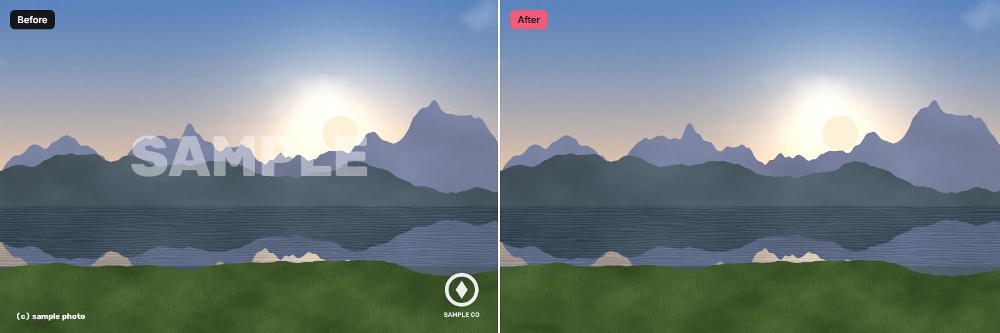
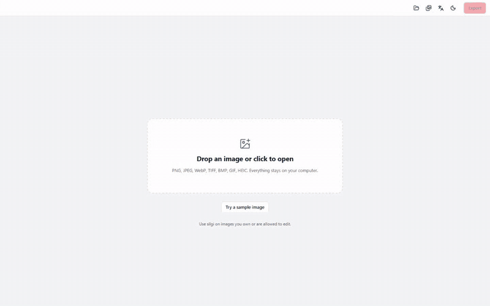
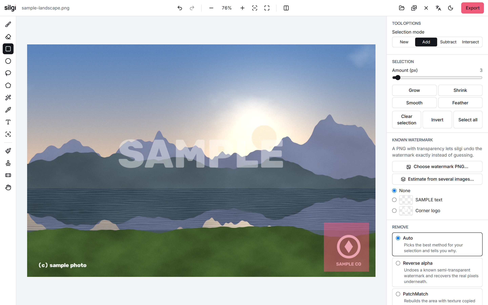
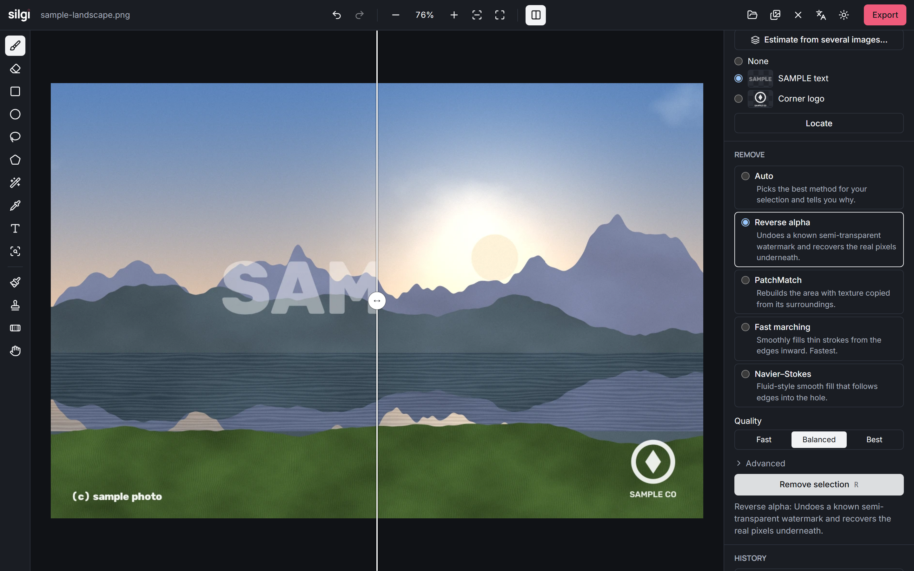
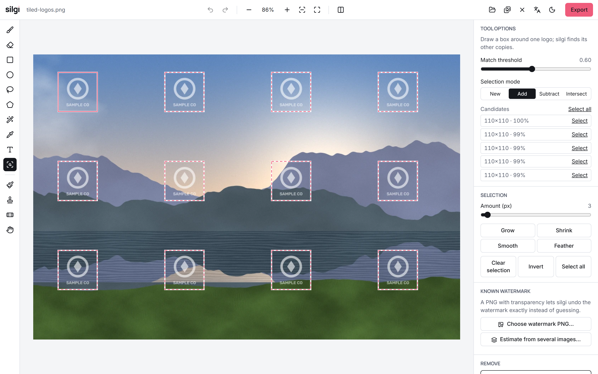
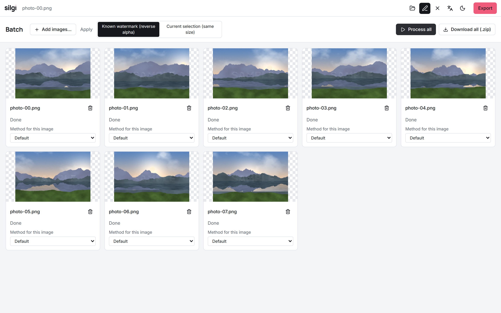
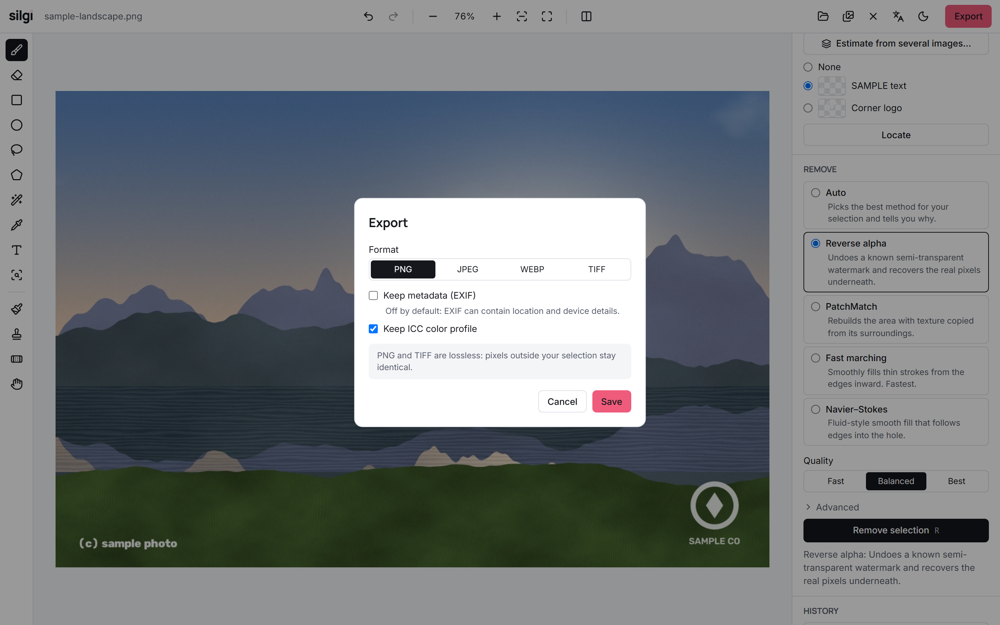

<div align="center">

<picture>
  <source media="(prefers-color-scheme: dark)" srcset="assets/brand/logo-dark.svg">
  
</picture>

**Remove watermarks without touching the rest of your image.**

[](https://github.com/tzeytun/silgi/actions/workflows/ci.yml)
[](LICENSE)
[](pyproject.toml)
[](https://pypi.org/project/silgi/)

</div>



silgi is an open-source, offline image tool: select a watermark, logo or text,
choose how, and it is gone. The rest of your image stays **bit-identical**, and
there is **no AI** involved, only classical image processing you can read and
reason about.

<div align="center">



</div>

## Features

**Removal methods**

- **Reverse alpha blending.** If you know the watermark (a PNG with transparency),
  silgi inverts `I = α·W + (1 − α)·J` and recovers the real pixels instead of
  guessing. Automatic alignment with sub-pixel refinement. With several images
  that share a watermark, silgi can **estimate** it for you.
- **PatchMatch.** Multiscale patch-based completion (the family behind classic
  "content-aware fill") for logos and objects over texture. Optionally restrict
  where texture may be copied from.
- **Fast marching and Navier–Stokes.** Very fast smooth fills for thin text.
- **Clone stamp and healing brush.** Manual touch-ups; healing uses Poisson
  blending so copied texture takes on the local lighting.
- **Auto.** Picks a method from the selection and its surroundings and tells you
  why.
- **Edge finishing.** Feathering and gradient-domain seam blending, strictly
  inside the selection.

**Selection tools**

- Brush and eraser (size, hardness), rectangle, ellipse, lasso, polygon lasso.
- Magic wand (contiguous or global) and color range with a live preview.
- **Text finder**: classical MSER + top-hat + stroke-width detection, no OCR. Accept
  candidate boxes one by one.
- **Find similar**: select one logo, find its other copies (tiled watermarks) with
  multi-scale template matching.
- Add, subtract and intersect; grow, shrink, smooth and feather; mask PNG
  import/export.

**Quality you can rely on**

- Original resolution, 8/16-bit depth, alpha channel and ICC profile preserved;
  EXIF is dropped unless you ask to keep it.
- Same input, mask and settings give the same bytes.
- Works on large images: the canvas is tiled, nothing 50 MP is loaded into the
  browser.
- Before/after slider, undo/redo history, cancellable jobs with a fast preview.
- English and Turkish interface, light and dark themes, keyboard accessible.

## Screenshots

| Editor (light) | Editor (dark, compare) |
|---|---|
|  |  |

| Selection tools: find similar | Batch mode |
|---|---|
|  |  |

| Export |
|---|
|  |

## Installation

```bash
pip install silgi
```

Optional extras: `pip install "silgi[heic]"` for HEIC files, `pip install "silgi[window]"`
for a desktop window.

From source:

```bash
git clone https://github.com/tzeytun/silgi && cd silgi
pip install -e ".[dev]"
cd frontend && npm install && npm run build && cd ..   # builds the UI into the package
```

## Quick start

```bash
silgi                 # starts the server and opens your browser
silgi --window        # ...or a desktop window (needs silgi[window])
```

Drop an image (or click **Try a sample image**), select what you want gone, press
**R**. Shortcuts: `B` brush, `M` rectangle, `L` lasso, `W` wand, `R` remove,
`C` compare, `Ctrl+Z` / `Ctrl+Shift+Z` undo and redo.

## Command line

```bash
# one image, with a mask (white = remove)
silgi remove input.jpg --mask mask.png --method auto -o out.png

# a known watermark: recover the pixels underneath, no mask needed
silgi remove photo.jpg --watermark logo-with-alpha.png -o clean.png

# a whole folder: find a logo in every image and remove it
silgi batch ./in ./out --template logo.png

# a folder of same-sized images with the same mask
silgi batch ./in ./out --mask mask.png --method patchmatch --quality best
```

Metadata is dropped by default; add `--keep-metadata` to keep EXIF. See
`silgi remove --help` and `silgi batch --help`.

## Use it as a library

`silgi.core` has no web dependencies.

```python
from silgi.core import read_image, remove, save_image
from silgi.core.select import rectangle

img = read_image("photo.jpg")  # upright pixels + ICC/EXIF
mask = rectangle(img.pixels.shape[:2], 1150, 690, 1325, 880)

result = remove(img.pixels, mask, method="auto")
print(result.method, "-", result.reason)  # which method, and why
save_image("clean.png", result.image, source=img)  # keeps depth, alpha, ICC
```

Known watermark:

```python
from silgi.core.alpha import remove as remove_watermark

wm = read_image("logo-with-alpha.png").pixels  # RGBA
clean = remove_watermark(img.pixels, None, watermark=wm)  # position found automatically
```

## How it works

Every method only sees the selection plus a margin and writes its result back
**only where the mask is set**, so pixels outside the mask cannot change. That is
a single function (`core/roi.py`), and a test checks it for every method, pixel
format and many random masks. [docs/algorithms.md](docs/algorithms.md) explains
each method in plain language with references; [docs/architecture.md](docs/architecture.md)
describes the server and the editor.

### Speed

Wall-clock time for one removal on a 16-core desktop CPU (AMD, Python 3.13).
Run time follows the *mask*, not the image: the mask is an ellipse covering 1 % or
5 % of a textured image. Reproduce with `python benchmarks/bench_speed.py`.

| Method | 2 MP / 1 % | 2 MP / 5 % | 12 MP / 1 % | 12 MP / 5 % | 24 MP / 1 % | 24 MP / 5 % |
|---|---:|---:|---:|---:|---:|---:|
| Fast marching (Telea) | 0.02 s | 0.13 s | 0.12 s | 0.59 s | 0.24 s | 1.20 s |
| Navier–Stokes | 0.02 s | 0.09 s | 0.11 s | 0.59 s | 0.24 s | 1.19 s |
| Heal | 0.06 s | 0.53 s | 0.60 s | 3.39 s | 1.59 s | 6.73 s |
| PatchMatch, fast | 0.07 s | 0.29 s | 0.31 s | 0.78 s | 0.44 s | 1.34 s |
| PatchMatch, balanced | 0.14 s | 0.58 s | 0.54 s | 1.76 s | 0.84 s | 3.19 s |
| PatchMatch, best | 0.32 s | 1.18 s | 1.17 s | 4.15 s | 1.87 s | 8.30 s |
| Reverse alpha | 0.01 s | n/a | 0.02 s | n/a | 0.03 s | n/a |

The first PatchMatch run in a process includes one-time compilation of the Numba
kernels (cached afterwards).

## Why no AI?

- **Deterministic.** The same input, mask and settings always produce the same
  bytes. No sampling, no hidden state.
- **Offline and private.** Nothing leaves your computer, there is no account and
  no model download; the server never makes a network request.
- **Honest.** Generative fills invent plausible pixels. silgi's reverse-alpha
  method recovers the *real* pixels when the watermark is known, and its other
  methods only copy or diffuse what is already in your image, so you can see
  exactly where they come from.
- **Small and understandable.** A few thousand lines of classical algorithms you
  can read, test and improve.

The trade-off: silgi will not hallucinate a missing face or complete a large
missing object. For big holes in complex scenes a generative tool may look better.

## Responsible use

silgi is for your own images, or images you have the right to edit. Removing
watermarks from other people's copyrighted work may be illegal where you live and
can violate licences and terms of service. You are responsible for how you use it.

## Roadmap

- More robust multi-image watermark estimation (iterative matting, scale search).
- Source-aware healing across layers and selections from a mask file in the UI.
- Video frames: reuse one estimated watermark across a sequence.
- Signed desktop installers.

Ideas and pull requests are welcome.

## Contributing

See [CONTRIBUTING.md](CONTRIBUTING.md) for setup, tests, code style and how to add
a new removal method. Please follow the [Code of Conduct](CODE_OF_CONDUCT.md).
Security issues: [SECURITY.md](SECURITY.md).

## License

Code: [MIT](LICENSE). The wordmark uses the Manrope typeface and the interface
bundles Manrope and Inter, both under the SIL Open Font License 1.1
([assets/brand/LICENSE-fonts.txt](assets/brand/LICENSE-fonts.txt)). The generated
sample images are CC0.

## Acknowledgements

silgi stands on the work of A. Telea; M. Bertalmío, A. Bertozzi and G. Sapiro;
A. Criminisi, P. Pérez and K. Toyama; C. Barnes, E. Shechtman, A. Finkelstein and
D. B. Goldman (PatchMatch); Y. Wexler, E. Shechtman and M. Irani; P. Pérez,
M. Gangnet and A. Blake (Poisson image editing); and T. Dekel et al. (visible
watermarks). Built with NumPy, OpenCV, SciPy, Numba, Pillow, FastAPI, React,
Vite, Tailwind CSS, Zustand and Lucide.
